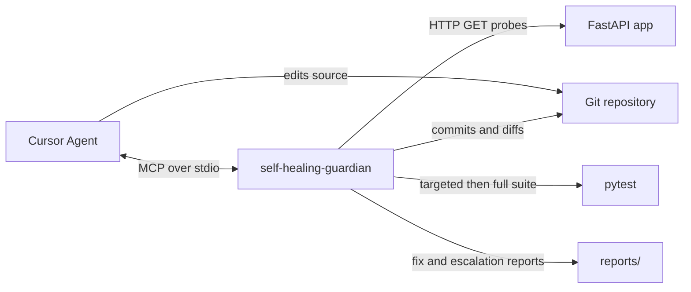
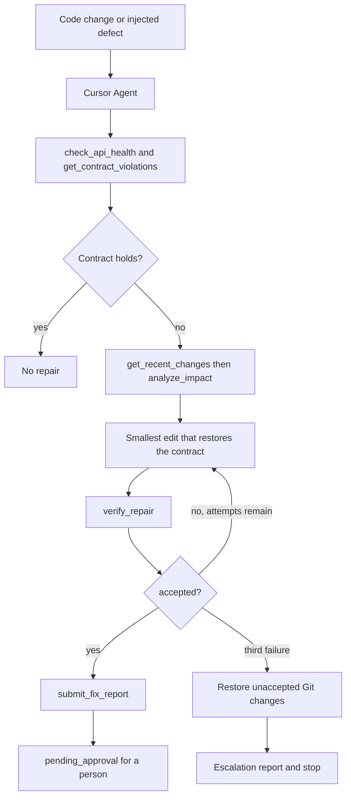
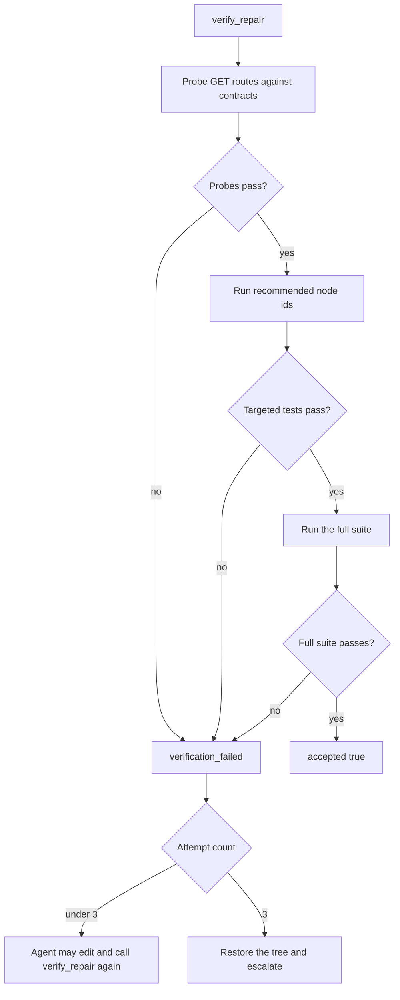

# Self-Healing API Agent

A FastAPI sample API plus a verification server that watches live responses against their contracts. When a change breaks a contract, Cursor Agent diagnoses the cause, edits the code, and the server proves the repair with probes and pytest. A passing repair is saved for a person to approve. After three failed verifications the server restores the unaccepted Git changes and writes an escalation report.

The contract is the source of truth. The agent restores behavior so responses match the schema. It does not rewrite the contract to fit a broken response.

## How it fits together

Three pieces work as one loop:

| Piece | Role |
| --- | --- |
| Sample API (`app/`) | Orders, invoices, and a revenue report. Orders own the totals. Invoices derive amount, tax, and total from those orders. The revenue report sums issued invoice totals. |
| Guardian (`mcp_server/`) | An MCP server named `self-healing-guardian`. It returns evidence: live schema checks, Git diffs, an import-graph impact map, pytest results, and a saved report. It does not edit code and it does not accept the agent's wording as a pass. |
| Cursor Agent | Reads the evidence, makes the smallest edit that restores the contract, then calls verification. A project rule in `.cursor/rules/repair-verification.mdc` is the required workflow. |

The guardian is not tied to this sample. Point `GUARDIAN_REPO_ROOT` at another FastAPI repository and it discovers that app's routes from the code.



## Repair flow

1. A developer changes the API, or the demo injector writes a known defect into a disposable worktree.
2. The API is already running. In Cursor, ask the agent to check, fix, and verify it with the guardian tools.
3. The agent calls `check_api_health` and `get_contract_violations`. The guardian probes each discovered GET route and compares the body with its contract.
4. The agent calls `get_recent_changes`, then `analyze_impact`. Impact analysis maps changed files through imports to the routes and tests that depend on them.
5. The agent edits the smallest change that makes responses match the contract again.
6. The agent calls `verify_repair` with the `recommended_nodeids` from impact analysis. The guardian runs contract probes, then those tests, then the full suite. The full suite starts only after the earlier checks pass.
7. A failed verification counts as one attempt. The agent may edit and verify again. The limit is 3 attempts.
8. On the third failure the guardian runs `git reset --hard HEAD` and `git clean` for unaccepted work, writes an escalation report, and stops. Reports, `.venv`, and `.cursor` stay on disk. The agent stops when `escalated` is true.
9. When the checks pass, the agent calls `submit_fix_report` with the diagnosis and the patch summary. The tool re-runs verification and sets the status itself. `accepted: true` and status `pending_approval` mean the checks passed and a person still has to approve.



`verify_repair` decides the verdict. Text the agent supplies is stored as notes.



A repeat call for the same source tree, base URL, and node ids reuses the finished result. Application imports are reloaded after the code changes, so a later probe validates the edited modules.

| Status | Meaning |
| --- | --- |
| `pending_approval` | Contract probes, targeted tests, and the full suite passed. A person reviews the report. |
| `verification_failed` | The current patch did not pass. Use the returned failures for another attempt, up to the limit. |
| `escalated` | Three verifications failed. Unaccepted Git changes were restored and an escalation report was written. Stop editing. |

## Repository layout

```text
app/                  Sample FastAPI application
  api/                Orders, invoices, and revenue routes
  schemas/            Response models
  services/           Order totals, invoice math, revenue aggregation
contracts/            Optional JSON Schema files, matched by title
mcp_server/           Guardian MCP server
  tools/              Health, Git, impact, tests, verification, reports
scripts/inject_bug.py Disposable demo defects
tests/unit/           Service tests
tests/integration/    API tests checked against the contracts
tests/mcp/            Guardian tests
scenarios/            Demo scenario notes
.cursor/mcp.json      Cursor launch config for this workspace
.cursor/rules/        Repair workflow the agent must follow
```

Reports default to `reports/` under the repository root. `repair-session.json` in that directory tracks the attempt count.

## Requirements

- Python 3.10 or newer (`list[str]` and `dict | None` annotations)
- Git, because rollback and change inspection use the repository

Python packages are listed in `requirements.txt`: FastAPI, Uvicorn, Pydantic, HTTPX, pytest, jsonschema, FastMCP, and GitPython.

## Setup

From the repository root:

```powershell
python -m venv .venv
.\.venv\Scripts\Activate.ps1
python -m pip install -r requirements.txt
```

On macOS or Linux, activate with `source .venv/bin/activate` and run `python` instead of the Windows launcher paths below.

### Start the sample API

```powershell
python -m uvicorn app.main:app --reload
```

- Interactive docs: `http://127.0.0.1:8000/docs`
- OpenAPI document: `http://127.0.0.1:8000/openapi.json`
- Health: `GET /health` returns `{"status": "ok"}`

| Method | Path | Response |
| --- | --- | --- |
| GET | `/orders` | List of orders |
| POST | `/orders` | Created order, or 409 when the id already exists |
| GET | `/orders/{order_id}` | One order, or 404 |
| GET | `/invoices` | List of invoices |
| GET | `/invoices/{invoice_id}` | One invoice, or 404 |
| GET | `/reports/revenue` | Invoice count and total revenue |

Sample order `101` is `total` `499.0` and `status` `shipped`. Invoice `INV-101` is amount `499.0`, tax `49.9`, total `548.9`. Revenue for the sample data is `823.9`.

### Run tests

In a second terminal, with the virtual environment active:

```powershell
python -m pytest
```

Unit tests cover the services. Integration tests call the API, validate bodies against the JSON Schema contracts, and check the OpenAPI definitions. `tests/mcp/` covers discovery, health checks, Git, impact analysis, and reports. A repository with no test suite is reported as such. A missing suite does not by itself fail verification.

## Contracts

GET routes are discovered from the FastAPI app, including list routes. Nested `$ref` values are resolved against the full OpenAPI document. One route that cannot be validated is reported on its own and does not abort the others.

A file in `contracts/` is applied when its `title` matches a response schema or, for a list, the item schema. Otherwise the OpenAPI response schema is the contract. Path parameters are filled from schema examples. A route with no usable example is skipped and reported.

| File | Title | Required fields |
| --- | --- | --- |
| `contracts/order.json` | `OrderResponse` | `id`, `total`, `status` |
| `contracts/invoices.json` | `InvoiceResponse` | `id`, `order_id`, `amount`, `tax`, `total`, `status` |
| `contracts/reports.json` | `RevenueReportResponse` | `invoice_count`, `total_revenue` |

`additionalProperties` is false on these schemas, so a renamed field is both a missing required field and an unexpected property.

## Guardian tools

Start the API first so probes can reach it. The server speaks MCP on stdin and stdout and writes logs to stderr. Cursor launches it from `.cursor/mcp.json`. Running it by hand:

```powershell
.\.venv\Scripts\python.exe -m mcp_server
```

| Tool | What it returns |
| --- | --- |
| `check_api_health` | Calls each discovered GET route and compares the body with its contract. |
| `get_contract_violations` | Missing fields, unexpected fields, wrong types, and other schema mismatches. |
| `get_recent_changes` | Recent commits, the latest diff, and any uncommitted diff. |
| `analyze_impact` | Changed files mapped through imports to affected routes and `recommended_nodeids`. |
| `run_targeted_tests` | Pytest for the node ids selected by impact analysis. |
| `run_full_tests` | The configured unit and integration suites. |
| `get_failure_evidence` | Failing tests, contract violations, and the latest change. |
| `verify_repair` | Contract probes, then targeted tests, then the full suite. Sets `accepted`. |
| `submit_fix_report` | Saves diagnosis and patch summary. Status comes from `verify_repair`. |

`analyze_impact` treats a module that imports changed code as downstream, along with the routes and tests that reference it. That chooses which tests run first. `verify_repair` still runs the full suite before a repair can be `pending_approval`.

The agent workflow is:

1. `check_api_health` and `get_contract_violations`
2. `get_recent_changes`, then `analyze_impact`
3. Smallest edit that restores the contract, including list responses and their items
4. `verify_repair` with `recommended_nodeids`
5. `submit_fix_report` with the diagnosis and the patch summary

A prompt that matches the project rule:

```text
The API may be broken. Use the guardian tools to check, fix, and verify it.
```

## Configuration

Settings are read when a tool runs.

| Variable | Default | Purpose |
| --- | --- | --- |
| `GUARDIAN_REPO_ROOT` | Directory that contains `mcp_server/` | Repository to inspect, edit, and test |
| `GUARDIAN_API_BASE_URL` | `http://127.0.0.1:8000` | Running API the probes call |
| `GUARDIAN_CONTRACTS_DIR` | `<repo>/contracts` | Optional JSON Schemas matched by `title` |
| `GUARDIAN_TEST_PATHS` | `tests/unit` and `tests/integration` when those directories exist | `os.pathsep`-separated pytest paths, relative to the repo |
| `GUARDIAN_REPORTS_DIR` | `<repo>/reports` | Fix reports, escalation reports, and `repair-session.json` |
| `PYTHONPATH` | Set by Cursor to the repo root | So `python -m mcp_server` can import the package |

If `GUARDIAN_TEST_PATHS` is unset and the unit and integration directories are absent, the server looks for `tests/`, then `test/`, then top-level `test_*.py` or `*_test.py` modules.

`.cursor/mcp.json` in this workspace starts `python -m mcp_server` with `GUARDIAN_REPO_ROOT` set to the Cursor workspace folder. To watch another checkout, point `GUARDIAN_REPO_ROOT` at that checkout, start its API, and set `GUARDIAN_API_BASE_URL` if it is not on port 8000. Copy the repair rule so the agent follows the same five-step workflow. The server reads route declarations and imports from the target code, so it does not need a handwritten endpoint table.

## Demo defects

`scripts/inject_bug.py` creates a disposable Git worktree and a `demo/failure-*` branch. It refuses to mutate `main` or `master` in place. `--in-place` is only for a checkout that is already a demo branch.

```powershell
.\.venv\Scripts\python.exe scripts\inject_bug.py --list
.\.venv\Scripts\python.exe scripts\inject_bug.py A
cd .worktrees\scenario-a
..\..\.venv\Scripts\python.exe -m pytest
```

Clean up with `python scripts/inject_bug.py --cleanup A` or `--cleanup-all`. More detail is in `scenarios/README.md`.

| Scenario | Injected defect | What detection should show | Correct outcome |
| --- | --- | --- | --- |
| A | `OrderResponse` serializes `amount` instead of `total` | Contract violation on `GET /orders/{id}` | Response includes `total` and matches `contracts/order.json` |
| B | Stored order totals are reduced by 10% | Incorrect invoice values and failed business assertions | Order 101 total is `499.0`, INV-101 total is `548.9`, revenue is `823.9` |
| C | Invoice totals omit tax (`total = amount`) | Downstream regression in invoices and the revenue report | Invoice totals include tax and revenue stays `823.9` |

Run the sample API from the worktree, or point `GUARDIAN_REPO_ROOT` at `.worktrees/scenario-a` (or `b` or `c`), before asking the agent to repair it. The guardian inspects and tests the configured root, and rollback restores that root.
